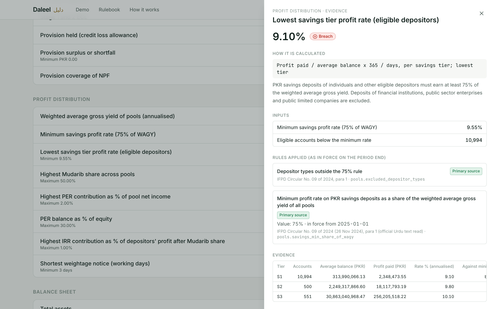
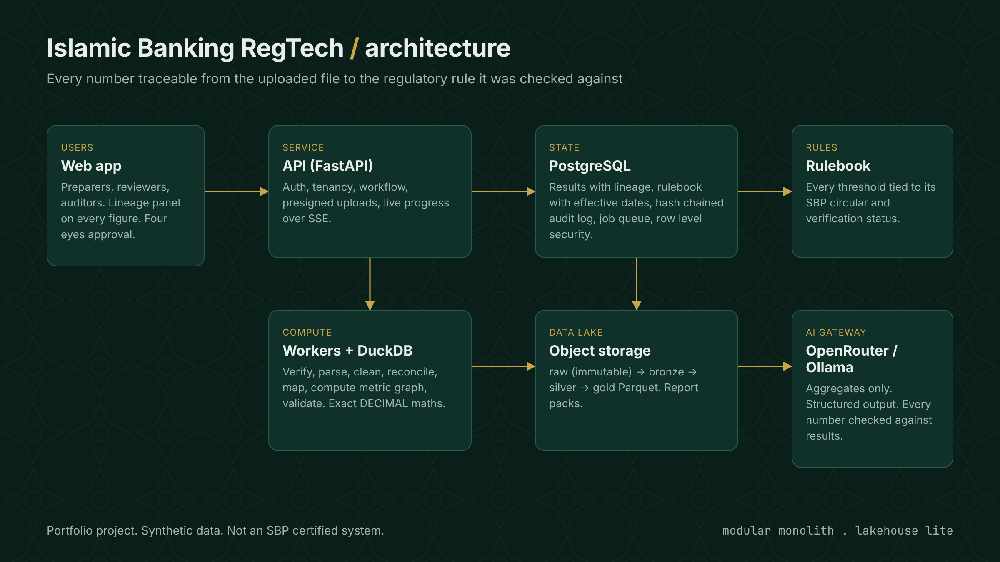

# Daleel <sub>دليل</sub>

**An Islamic bank regulatory compliance tool.** Every figure carries its evidence.

Daleel (Arabic for *evidence* or *proof*) takes a raw core banking export from an Islamic bank in Pakistan, shows exactly how it reads and transforms it, and produces State Bank of Pakistan (SBP) regulatory results. Any number can be clicked to see the rows, the rule and the circular behind it. An AI breakdown explains the results, and it is designed so that it cannot invent a number.

> Portfolio project. The demo runs on synthetic data for a fictional bank, *Example Islamic Bank Ltd*. Results are not certified by SBP or by any compliance, legal or Shariah adviser.



## What it does

1. **Upload** a bank export: trial balance, contract level financing portfolio, deposits, investment pools and capital memo items, as messy T24, Flexcube or spreadsheet exports (`.xlsx`, `.csv`, `.parquet`).
2. **Transform** it into the *Daleel Standard Template*. Daleel finds the real header rows and recognises each dataset and source system. It maps every column and cleans every value: thousands separators, DR and CR suffixes, brackets, scientific notation, day first dates, percentages and product spellings. Every fix is counted and shown before and after. Unreadable cells reject their row with a reason; they are never turned into zero. The clean result can be downloaded as the "ideal ingestion document".
3. **Reconcile and calculate.** The trial balance must balance, and the portfolio and deposits must agree to the ledger. Then Daleel computes:
   - capital adequacy: CET1, Tier 1 and total CAR with the conservation buffer, the IFRS 9 transitional add back and the leverage ratio
   - IFRS 9 staging from SBP's Annexure C day bands, ECL and Prudential Regulations provisions, with the higher of the two for Stage 3
   - pool rules: the 75% savings profit rule (IFPD Circular No. 09 of 2024), the Mudarib share cap, and the PER, IRR and weightage notice limits
   - Shariah checks
4. **Explain.** A grounded AI breakdown cites SBP excerpts word for word. A grounding report shows what was checked.
5. **Audit.** Every step lands in a hash chained, append only audit log that can be verified in one click.

## How hallucination is designed out

The calculation engine is deterministic; the AI computes nothing. Then:

- **The model never sees a number.** It gets facts with ids and statuses and writes placeholders such as `{F3}`. The app replaces each one with a phrase rendered by the engine, for example "9.10%, 0.45 percentage points below the 9.55% minimum".
- **Regulation comes from retrieval, not memory.** Excerpts are retrieved from primary SBP documents with PostgreSQL full text search. The clause a rule cites is fetched first. The model can only point at an excerpt by id, and the interface shows the original text.
- **Every reply is validated before display.** The checks are:
  - no digits outside placeholders
  - placeholders must belong to cited facts
  - citations must exist and relate to the cited facts
  - wording must match the status, so "meets" is never used for a breach
  - each fact must be named with its own words
  - every breach must be covered
- **Safe failure.** One retry with the list of problems. If it still fails, a deterministic summary is shown and labelled as such.

## Architecture



| Layer | Choice | Why |
|---|---|---|
| API and worker | Python 3.13, FastAPI, a job queue in PostgreSQL (`FOR UPDATE SKIP LOCKED`) | One codebase; jobs are enqueued in the same transaction as their data |
| Bulk data | DuckDB on Parquet (medallion layout: raw, silver, gold) | Columnar, exact `DECIMAL(38,4)` arithmetic, uses every core, no cluster |
| State | PostgreSQL with **forced row level security** per workspace, hash chained audit log | The database itself prevents cross workspace access, even if the app has a bug |
| Rules | Versioned YAML rulebook with effective dates and sources | Any past period is recalculated with the rules of its time |
| AI | OpenRouter free models (demo), Ollama (on premises), lexical RAG over primary SBP PDFs | Free, swappable, and in production no bank data leaves the bank (SBP cloud framework) |
| Web | React 19, TypeScript, TanStack Query, Tailwind CSS v4, Server Sent Events | Live progress, dense and accessible screens, light and dark themes |

Design decisions are recorded with alternatives in [docs/06-system-design.md](docs/06-system-design.md) (DEC-001 onward).

## Run it locally

With Docker:

```bash
OPENROUTER_API_KEY=your-free-key docker compose up --build
```

Then open http://localhost:7860. Without a key, set `AI_PROVIDER=off` and Daleel uses its deterministic summary.

For development, you need Python 3.12+, [uv](https://docs.astral.sh/uv/), Node 22, pnpm and PostgreSQL 16+. Create the database once:

```bash
psql -U postgres -c "CREATE DATABASE daleel" -d postgres
```

```bash
psql -U postgres -d daleel -f infra/db-init.sql
```

Start the API (it migrates, indexes the SBP sources and generates the samples on first start):

```bash
cd backend && cp .env.example .env && uv sync && uv run daleel serve
```

Start the web app (in a second terminal):

```bash
cd web && pnpm install && pnpm dev
```

Run the tests:

```bash
cd backend && uv run pytest
```

Free hosting (Supabase, Hugging Face Spaces) is described in [docs/09-deployment.md](docs/09-deployment.md).

## Repository map

```
backend/        Python package `daleel`: ingestion, mapping, metrics, checks, AI, API, migrations, tests
web/            React app
rulebook/       regulatory rules as data (effective dates, sources, verification status)
mappings/       illustrative reporting codes and the demo GL mapping
docs/           design, bug register, fix log, concepts, regulatory verification, roadmap
docs/sources/   SBP circulars used for retrieval, with an unofficial translation where needed
social-media/   build in public posts, articles and screenshots
```

## Status and limits

- SBP's Reporting Chart of Accounts and DAP4 file layouts are distributed only to banks, so Daleel uses illustrative reporting codes and does not produce a certified SBP return.
- Rule values are labelled *primary* (read in the SBP document), *secondary* or *demo assumption*; see the in app rulebook and [docs/05-regulatory-verification.md](docs/05-regulatory-verification.md). Assumptions never raise a breach on their own.
- Capital uses a simplified standardised approach; market and operational risk RWA are taken from the bank's memo.
