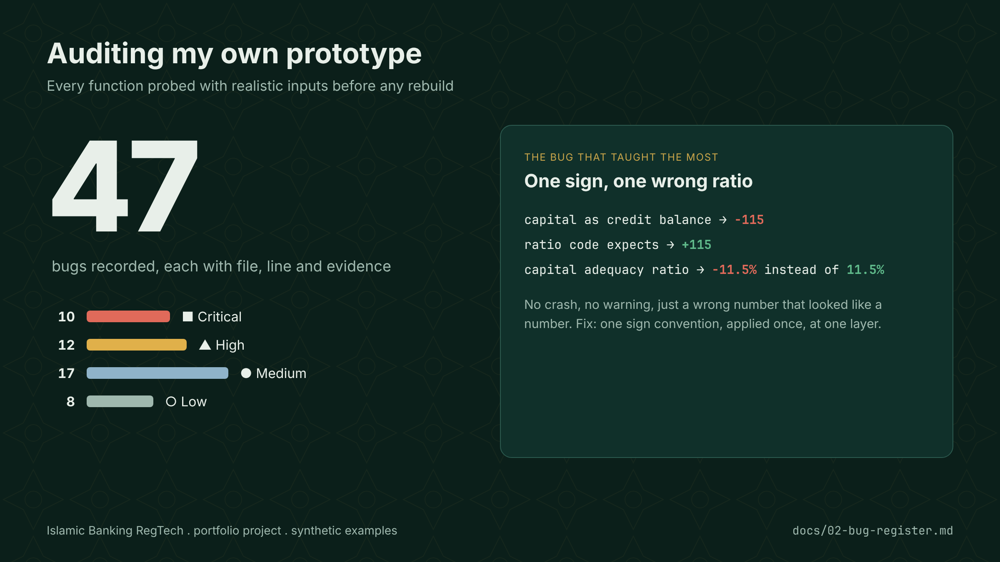
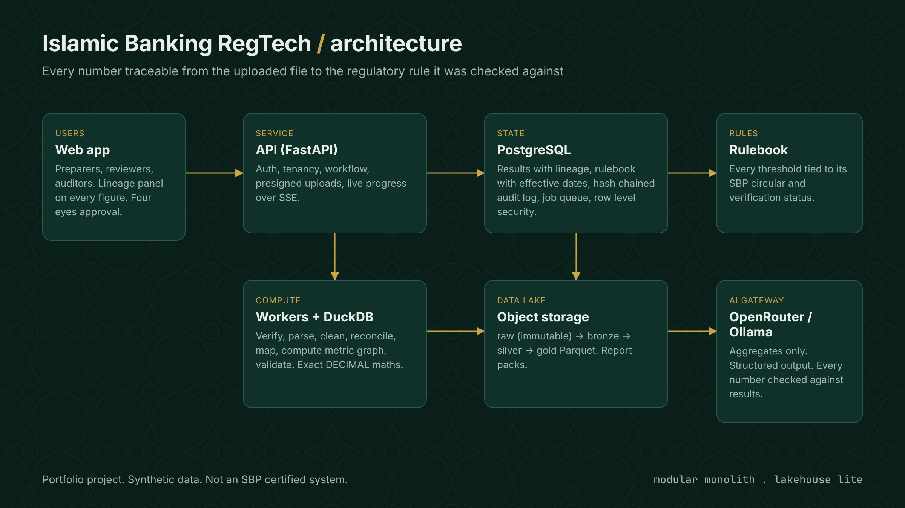

# Building a Regulatory Reporting Engine for Islamic Banks, Part 1: Audit, Verify, Then Design

*Week 1 | Images: `../assets/audit-by-numbers.png`, `../assets/architecture-overview.png`*

---

Every month, an Islamic bank in Pakistan has to turn millions of ledger entries into a few numbers that the State Bank of Pakistan (SBP) watches closely. How much capital does the bank hold against its risks? How much of its financing has gone bad? Did it share enough of its profit with savings depositors?

Those numbers carry personal accountability. Someone signs off on them, auditors test them, and the regulator acts on them. In practice, a lot of the journey from the core banking system to the final figure still runs through exports, spreadsheets and manual checks.

I am building a system that automates that journey and keeps every step traceable. This is the first article in a series that documents the build in public. It is a portfolio project: the demo uses a fictional bank, "Example Islamic Bank Ltd", and synthetic data built to real structures. Nothing here is certified by SBP or a compliance function.

This part covers what happened before writing any new code: an audit of the prototype, a fact check of its regulatory claims, and the system design that came out of both.

## Step 1: Audit the prototype, and run the code

I started from an existing prototype: a Python backend with three layers.

1. **Ingestion** reads the bank's trial balance file.
2. **Normalisation** maps the bank's own account codes to SBP's reporting codes.
3. **Calculations** compute ratios such as the capital adequacy ratio (CAR) and the non performing financing (NPF) ratio.

The rest of the system existed only as empty files: the API, the database, the frontend and the tests.

I reviewed every line while wearing three hats: software engineer, accountant and compliance officer. Then I did something that changed the result: I ran every function with small, realistic inputs. I used a T24 style CSV, an Excel export and a set of sample balances.

The audit found **47 bugs, 10 of them critical**, and 14 missing pieces.

Some were simple. An encoding name was typed as `utr-8-sig` instead of `utf-8-sig`, so every CSV failed before reading a single row. Excel files were checked for an internal file called `[Content_Types.xml]`, when the real name is `[Content_Types].xml`, so every Excel upload was rejected.

Others were more interesting.

**The sign bug.** In double entry accounting, assets normally sit on the debit side, while capital, deposits and income sit on the credit side. The file reader stored every balance as debit minus credit. That is a valid convention, but it makes capital negative. The calculation code assumed capital was positive. Nothing in between converted one convention into the other.

I fed the same balances through the CAR calculation twice. With capital entered as positive, CAR was 11.5%. With capital entered the way the reader would actually produce it, CAR was **minus 11.5%**. No error was raised. The system simply produced a wrong number that looked like a number.

**The silent zero.** An unreadable cell, for example corrupted text where a balance should be, was quietly turned into zero. A bank with no mapping file was silently given the sample mapping. Accounts with no mapping rule were grouped under "UNMAPPED" and fell out of every ratio. In regulatory reporting, a silent error is far more dangerous than a crash. A crash gets fixed the same day. A silent zero can end up in a filing.

**Running code corrected my own reading.** Reading the code, I was sure one line would stop a file from loading. Running it showed the line was valid Python that only failed when a balance ended in "DR". I was also sure that the file hashing function had no body. Running it showed it worked and returned the correct SHA-256. Both corrections went into the bug register, along with a script that reproduces every finding.

Every bug now has an entry with the file, the line, the severity, the evidence, how it was found, and a planned fix with the same number. Every one will become an automated regression test.

## Step 2: Fact check the regulation, including the fact checks

The prototype contained a careful looking note on which regulatory references were verified and which "looked invented". Among the "invented" ones:

- SBP's Islamic Finance Policy Department (IFPD)
- IFPD Circular No. 09 of 2024
- IFPD Circular No. 08 of 2024
- BSD-1 Circular No. 01 of 2025

All four appear to be real. IFPD is an SBP department set up in December 2022. Circular No. 08 of 2024 is the revised Shariah Governance Framework. BSD-1 Circular No. 01 of 2025 revised the data file structures banks use to submit returns. And Circular No. 09 of 2024 is the source of the exact rule the code was trying to implement:

> From 1 January 2025, Islamic banks must pay profit on rupee savings deposits at a rate of at least 75% of the weighted average gross yield of their investment pools.

Because the real source had been set aside, the code tested the wrong thing. It compared a share of income, when the rule compares a profit rate with a pool yield. Worse, the depositor share was hard coded at 55%, so the check reported a breach on every submission, whatever the data.

What I changed in response:

- **One regulatory log.** Every regulatory number now has one entry with its source, the date it was checked, and a status: verified from the primary source, secondary (news, bank disclosures or quoted SBP text), claimed, or unverified.
- **Unverified values never raise alarms on their own.** They can be shown, but they cannot trigger a breach.
- **Rules are data, not code.** Each threshold is stored with "valid from" and "valid to" dates and a link to its log entry. Recalculating March 2024 uses the rules of March 2024.

One honest limit: the research environment could not open the SBP website directly, so every fact is currently marked "secondary". The next step is to read the primary circulars and upgrade them. The point of the log is that this status is visible, not hidden.

## Step 3: Design for the data a real bank has

A trial balance is small, a few thousand rows. But the regulatory checks need much more than that:

- To test the 75% rule, you need the balances of savings deposits, often daily.
- To classify financing as performing or non performing, and to calculate provisions and expected credit loss, you need every financing contract with its days past due.

For a large Islamic bank, that can mean millions of accounts and around **240 million daily balance rows per month**.

The main design decisions:

**Two storage engines, each doing what it is good at.** PostgreSQL holds the state the application reads and writes: users, submissions, approvals, results, the rulebook and the audit log. Bulk data goes to object storage as Parquet files, a compressed columnar format, and is processed by DuckDB. DuckDB is an embedded analytical engine with exact decimal arithmetic. It uses every CPU core and handles data larger than memory, with no cluster to run. The same code runs on a laptop, a bank's own server or a cloud container.

**A medallion layout.** Files move through raw (exactly as uploaded, never changed), bronze (typed), silver (cleaned, with customer identifiers pseudonymised) and gold (aggregated to reporting codes). Any number can be traced back down the layers to the original file.

**Integrity checked from end to end.** Large files go straight from the browser to storage. The browser hashes the file while uploading, and the worker hashes it again from storage. If the hashes differ, the file is rejected. That is the chain of custody.

**Reconciliation as a first class step.** The financing portfolio must add up to the financing accounts in the trial balance, and the deposits must add up to the deposit accounts. Differences are failures, not footnotes. This is how real regulatory reporting catches a branch missing from an extract.

**Every number carries its lineage.** Each metric is a small function that declares its inputs. The engine runs them in order and stores every result with its inputs, the rule versions, the mapping version, the file hashes and the code version. In the interface, any number can be clicked to see where it came from.

**A modular monolith.** One codebase, deployed as an API process and worker processes, with strict module boundaries checked automatically. It is simple to run, and any module can be split out later if it ever needs to scale on its own.

**Security fit for a bank:**

- Row level security in PostgreSQL, so one bank can never see another bank's rows, even if the application has a bug
- Four eyes approval enforced by both the software and the database
- An audit log in which every entry includes a fingerprint of the previous one, so any edit breaks the chain
- Modern password hashing (Argon2id) and short lived tokens

**AI that is not allowed to invent numbers.** The system uses AI for four jobs:

1. writing an executive summary
2. suggesting account mappings
3. reading new SBP circulars
4. answering analyst questions

Every feature follows the same rules. The AI only ever sees aggregated figures. Its output must match a strict schema. Every number in its text is checked against the calculated results, and anything that does not match is flagged. It can only make suggestions that a human accepts.

For the public demo, the AI runs through a cloud model provider (OpenRouter), routed only to providers that do not keep the data, and the demo data is synthetic anyway. In a real bank it would run on a local model (Ollama). SBP's cloud framework keeps material bank workloads onshore, and customer data should never leave the bank.

## What comes next

The build follows a milestone plan:

1. **Foundations:** repository, continuous integration, locked dependencies, and safety rules for data and secrets
2. **A synthetic data generator** calibrated to SBP's Islamic Banking Bulletin. It deliberately includes the problems found in the audit (DR suffixes, odd encodings, unmapped accounts, a one paisa trial balance difference) so the pipeline has to catch every one
3. **The ingestion engine**
4. **Mapping**
5. **The rulebook and calculations:** classification and provisioning, expected credit loss, capital adequacy, and the pool rules including the 75% test
6. **Validation and four eyes approval**
7. **The platform:** API, security and audit
8. **The web app**, designed for the compliance officers who will use it every day
9. **Reports**
10. **AI**
11. **The public launch**

The next article covers the calculation engine and how lineage works in practice.

*If you work in regulatory reporting, Islamic finance or data engineering, I would value your feedback, especially on what your team finds hardest to trace today.*

---

*This is a portfolio project using synthetic data for a fictional bank. It is not legal, compliance or Shariah advice, and its rules must be confirmed against current SBP instructions by a qualified compliance function before any real use.*
