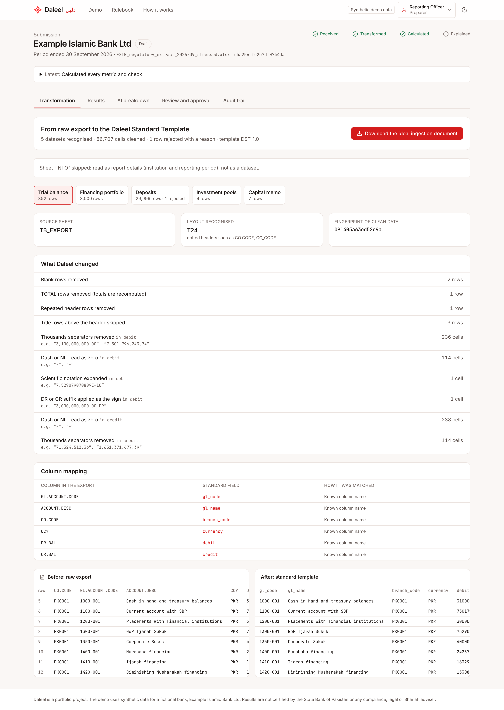
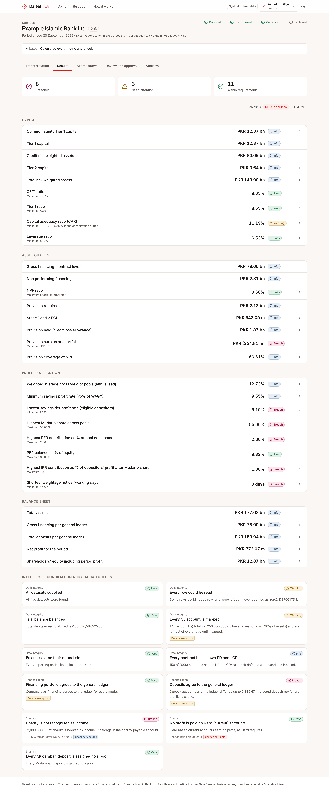
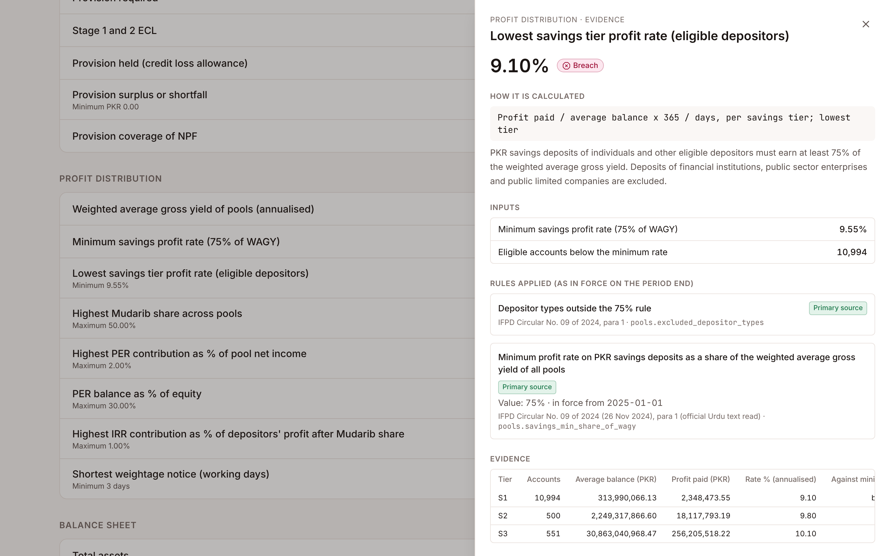

# Building a Regulatory Reporting Engine for Islamic Banks, Part 2: From a Messy Export to Numbers With Evidence

*Week 3 | Images: `../assets/screens/03-transformation.png`, `../assets/screens/05-results.png`, `../assets/screens/06-evidence-drawer.png`*

---

Part 1 covered the audit of my prototype and the design that came out of it. This part is about the engine of Daleel (Arabic for *evidence*): how a messy bank export becomes regulatory figures that can each prove where they came from.

Everything here runs on synthetic data for a fictional bank, Example Islamic Bank Ltd. The rules are labelled by source, and nothing is certified by SBP.

## 1. Start with data that fights back

A test that only sees clean data proves very little. So the demo bank comes as a deliberately messy export. It has:

- title rows above the header
- a header repeated after a page break
- a TOTAL row at the bottom
- T24 style dotted column names next to Flexcube style names
- amounts written as "3,000,000,000.00 DR", "(500)" and "-"
- one amount in scientific notation
- day first dates
- PDs as "1.2500%" or "0.0125"
- the same product spelled "Diminishing Musharaka", "DM" and "DIMINISHING MUSHARAKAH"

The stressed version adds a cell that says `#REF!`.

The bank itself is built from the bottom up. Contracts, accounts and pools come first, and the general ledger is derived from them. So the trial balance reconciles to the rupee, and the reconciliation checks have something real to test.

## 2. Ingestion: read, recognise, transform, and say so

Daleel reads every sheet as text first, so nothing is rounded before cleaning. Then:

1. **Find the real table.** The header is the row that matches the most known column names. Title rows, blank rows, repeated headers and TOTAL rows are dropped and counted. Totals are always recomputed, never trusted.
2. **Recognise the dataset and the system.** Each sheet is scored against five canonical schemas: trial balance, financing, deposits, pools and capital memo. Dotted headers suggest T24; names such as `CONTRACT_NO` and `OS_BALANCE` suggest Flexcube.
3. **Map the columns.** An exact known name comes first, then a close spelling (a fuzzy score of at least 88), and only then an optional AI proposal. An AI proposal is accepted only if the column's values actually parse as the right type.
4. **Clean in SQL.** Each field type has a DuckDB macro that returns the clean value and, separately, a label for the fix it made. Over the whole demo file that is 86,707 cells, each counted by type with raw examples.
5. **Never guess.** A cell that cannot be read rejects its row, with the row number and reason ("unreadable amount '#REF!' in AVG_BAL"). It is never turned into zero.

The output is the *Daleel Standard Template*: canonical Parquet for the engine, plus an Excel "ideal ingestion document" the bank can download. It has a dictionary, the clean data, every fix and every rejected row.

## 3. Trust before arithmetic

Before any ratio, the data must hang together:

- **The trial balance must balance.** This check caught my own mistake. My first sample wrote one large balance in seven digit scientific notation and lost PKR 332.12. Daleel refused the file.
- **The financing portfolio must agree to the ledger**, mode by mode.
- **Deposit accounts must agree to the ledger**, product by product. In the stressed file they are out by PKR 3,386.67, which is exactly the one rejected row. The check says so.

## 4. One sign convention, one mapping rule

Mapping happens at the gold layer, where each GL account goes to a reporting code.

- **Signs.** Amounts are signed debit positive and *presented* positive on each code's normal side. Capital, a credit, shows as a positive number; an asset, a debit, also shows as positive. An account on its wrong side is flagged, never flipped silently. This single rule fixed the worst bug from the audit, where a CAR of 11.5% came out as minus 11.5%.
- **Matching.** Patterns must match the whole GL code, overlaps are reported, and apportionment uses exact decimal shares with the remainder given to the largest share. A property test tries hundreds of random amounts to prove the split always adds back.

## 5. The rulebook and the metric graph

Every threshold lives in a YAML rulebook with dates and sources. For example, the capital conservation buffer has two versions:

- 2.5%, in force until March 2020 (BPRD Circular No. 06 of 2013)
- 1.5%, in force from 26 March 2020 (a COVID relief letter, secondary source)

A calculation asks for the version in force on its reporting date. Of the 26 rules, 17 have a version verified in a primary SBP document:

- the IFRS 9 Annexure C stage bands
- the Basel III minimums
- the Tier 2 provision cap
- the transitional add back
- the 75% rule, read in the circular's official Urdu text
- the pool limits: Mudarib share 50%, PER 2% a month and 30% of equity, IRR 1%

Each metric is a small Python function that declares the metrics it depends on and the rules it uses. The engine sorts them in dependency order and stores every result with its formula, inputs, rule versions and evidence table.

Heavy work runs in DuckDB SQL. For example, one query classifies every contract with SBP's Annexure C bands, then applies:

- Stage 1: 12 month PD x LGD x exposure
- Stage 2: lifetime PD x LGD x exposure
- Stage 3: the higher of ECL and the Prudential Regulations provision

## 6. Click any number

On the stressed bank, the lowest savings tier earns 9.10%, against a minimum of 9.55% (75% of a weighted average gross yield of 12.73%). Clicking it shows:

- the formula in plain words
- the inputs, including 10,994 eligible accounts below the minimum
- the two rules used, both from primary sources, with paragraph references
- the evidence table by tier

That is the whole point of the name.

## 7. Does it scale?

The heaviest input for the 75% rule is daily balances. For a large bank that is 8 million accounts x 30 days = 240 million rows. On a 4 CPU cloud machine, DuckDB wrote them to Parquet in 41 seconds (1.1 GB). It then averaged every account and totalled by tier in **3.9 seconds**, in exact decimal arithmetic, with no cluster.

*Next: Part 3, an AI summary that is not allowed to write a single number.*

---

*Portfolio project on synthetic data for a fictional bank. Not legal, compliance or Shariah advice.*
