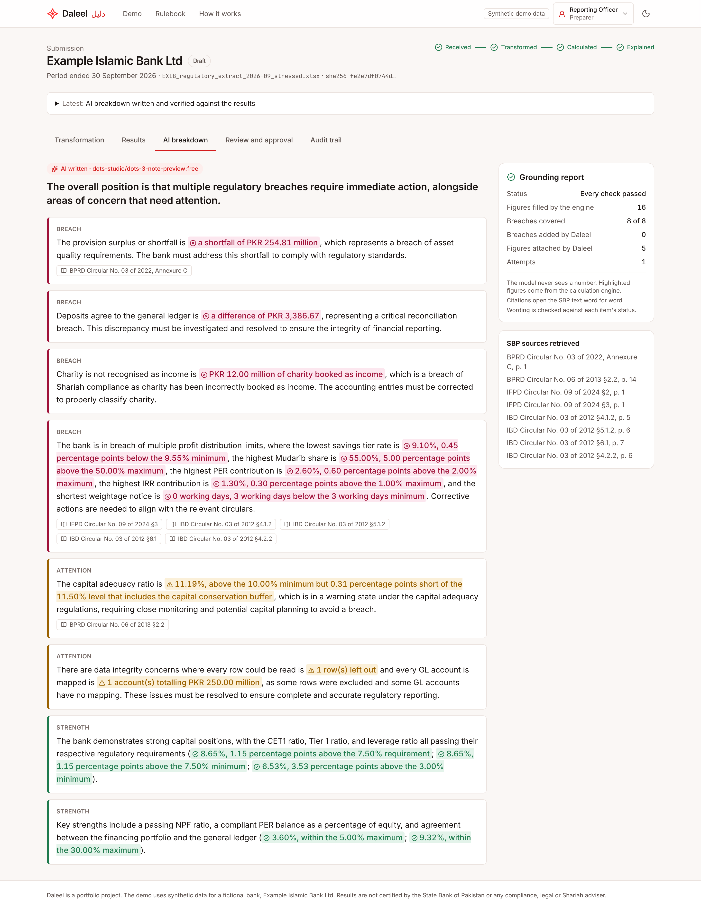
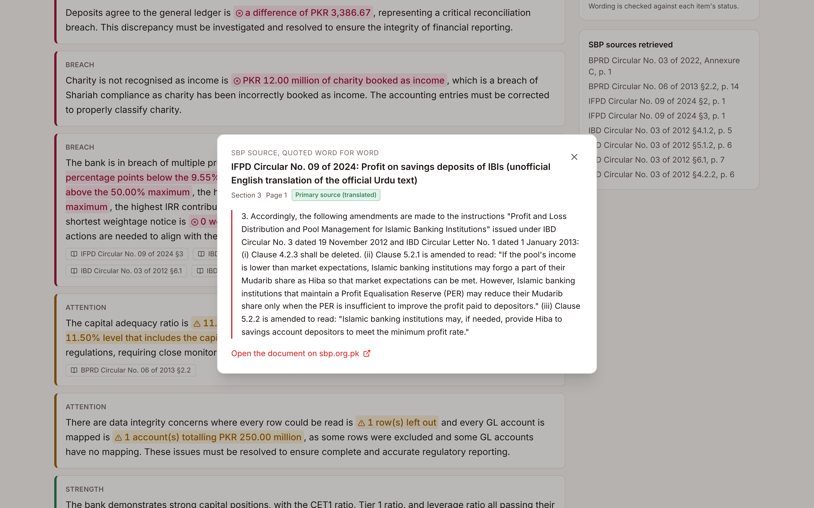

# Building a Regulatory Reporting Engine for Islamic Banks, Part 3: An AI That Is Not Allowed to Write Numbers

*Week 5 | Images: `../assets/screens/08-breakdown-ai.png`, `../assets/screens/09-citation.png`*

---

Compliance teams want plain language summaries. They do not want a language model that might say a capital ratio is 12.19% when it is 11.19%. For Daleel I wanted both: a readable AI breakdown, and no way for it to state a wrong number.

The usual approach is to give the model the numbers, ask it to be careful, and check afterwards. Daleel removes the possibility instead.

## The model never sees a number

The deterministic engine has already computed everything. The AI computes nothing. What the model receives is a fact sheet like this:

```json
{"id": "F21", "label": "Capital adequacy ratio (CAR)", "status": "WARNING", "category": "Capital"}
```

No value, no limit, no gap. To mention the figure it writes a placeholder:

> The capital adequacy ratio is {F21} and requires attention.

Daleel then replaces `{F21}` with a phrase rendered by the engine:

> 11.19%, above the 10.00% minimum but 0.31 percentage points short of the 11.50% level that includes the capital conservation buffer

A model that never receives a digit cannot copy one wrongly, round it, or invent one. In the interface each inserted phrase is highlighted, so the reader can tell the engine's words from the model's.



## Regulation from retrieval, not memory

When a point explains the regulatory basis, the model cites an excerpt id such as `IFPD-C09-2024#3`. It never quotes text. The excerpts come from SBP's own PDFs, downloaded and indexed with PostgreSQL full text search. Retrieval is structured first:

- A rule already names its document and clause, for example "IBD Circular No. 03 of 2012, Annex, 4.1.2". That exact clause is fetched first.
- Keyword search is used only inside the documents a rule names.
- A fact whose rules name no document in the corpus gets no citation at all. I added that after the model cited a profit equalisation clause for a charity breach. It was loosely related, and wrong.

Clicking a citation shows the SBP text word for word, with its section, page and source status.



## Every reply is checked before anyone sees it

The reply must match a strict JSON schema. Then a validator rejects it if:

- any digit appears outside a placeholder (a small allow list covers names such as "Tier 1" and "IFRS 9")
- a placeholder belongs to a fact the point does not cite
- a cited excerpt does not exist, or does not relate to the cited facts
- the wording contradicts the status, for example "meets the requirement" about a breach, or "breach" about something that passed
- a cited fact is not named in its own words

That last rule came from a real failure. A free model wrote about the "highest return of equity contribution". It meant the IRR, the investment risk reserve. No number was wrong, but the words were, so now each fact must be recognisable by a distinctive word from its own label.

Two things are repaired rather than rejected, because the repair is deterministic and cannot introduce an error:

- a point that cites a fact but forgets to show it gets the engine's value appended
- a breach the model leaves out entirely is added from a template and labelled "added by Daleel"

If a reply fails, the model gets one retry with the exact list of problems. If it fails again, a deterministic summary is shown, and the screen says so. A grounding report beside the text shows:

- how many figures came from the engine
- how many breaches were covered
- how many attempts it took

## Free, and swappable

The demo uses free models through OpenRouter's OpenAI compatible API, with a fallback list. I learned that list may hold at most three models per request: a 400 error, caught by the fallback path. The same gateway speaks to Ollama on premises.

That matters in Pakistan. SBP's framework on outsourcing to cloud providers keeps banks' material workloads onshore unless SBP approves otherwise. Customer level bank data should not be sent to a foreign AI API. The cloud path in the demo only ever sees aggregated, synthetic facts.

Free models are slow, sometimes minutes. So the deterministic summary appears the moment the calculations finish, and the AI version replaces it when it passes validation.

## What this design does and does not solve

**It removes:**
- numeric hallucination
- invented regulation
- silent omission of breaches

**It reduces, without removing:**
- awkward or vague wording
- a loosely chosen citation inside the right document

That is why the evidence panel, not the AI, remains the source of truth. The AI explains; the engine decides.

---

*Portfolio project on synthetic data for a fictional bank. Not legal, compliance or Shariah advice.*
